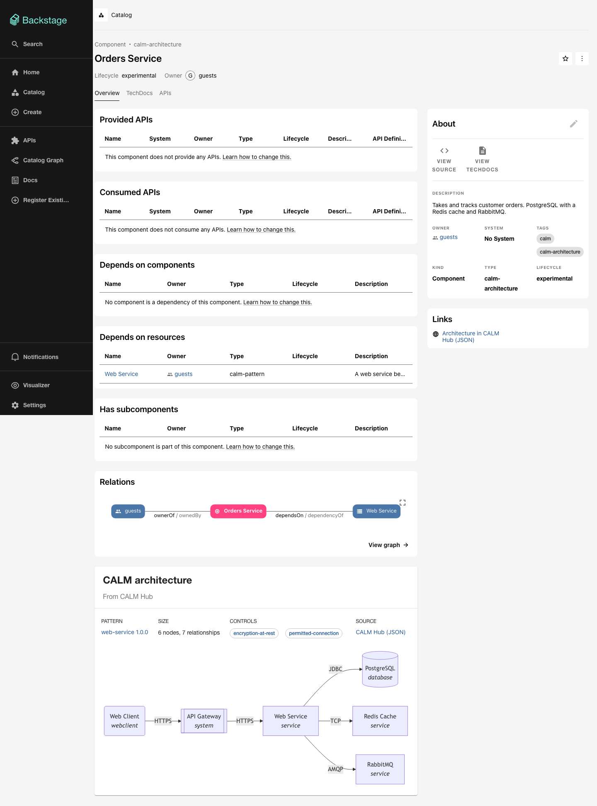
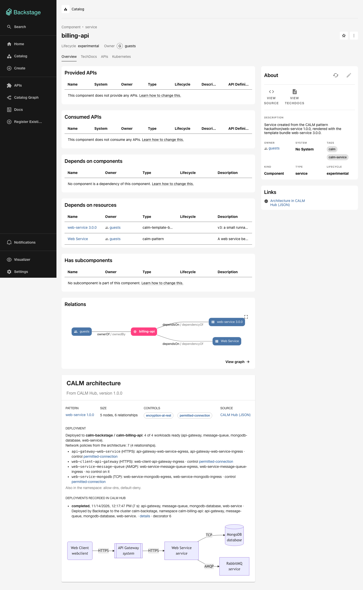

# CALM Backstage

A clone-and-run base for the CALM hackathon. A developer sees CALM architectures in the Backstage catalog, sees the
architecture on a service page, and creates a new service from a CALM pattern, with the pattern's options as form
choices. Template bundles decide what the service gets: a *starter* (its code: Node, Spring Boot, Red Hat build of
Quarkus, or a Nisshi event-streaming app) and *deployment rules* (how any service runs on Kubernetes). Each service
lives in its own Git repository and Flux deploys it; Backstage opens it as a running app, and upgrades its code and
its deployment rules through a pull request.



## Start

You need Docker, Node 26 and the repository's own Yarn (`.yarn/releases`, picked up by any global `yarn`).
`engines` also allows Node 22 and 24, but the base has only been run on 26.

```sh
(cd ../calm-import && npm ci)   # the diagram converter the backend links; builds its dist/
yarn install
yarn hub:up && yarn hub:seed    # Hub on 127.0.0.1:8090, registry on 127.0.0.1:5050, Gitea on 127.0.0.1:3300 (seeded, idempotent)
yarn k8s:up                     # local Kubernetes (minikube profile calm-backstage, 6 GiB, 4 CPUs) with Flux
yarn start                      # Backstage on http://localhost:3100 (backend on 7107)
```

`yarn k8s:up` needs `minikube` and `kubectl`. It keeps its kubeconfig in `.kube/` inside the repository, so your own
kubeconfig, its current context and other minikube profiles are not touched. It installs Flux's source and kustomize
controllers from the pinned release (no `flux` CLI). `yarn k8s:down` deletes the cluster.

Gitea (http://localhost:3300, user `calm`, password `calm-local-dev`, local development only) stands in for GitHub:
`calm-templates/bundles` holds the bundle sources and `calm-services/<name>` one repository per service. Flux in the
cluster reaches it as `http://host.minikube.internal:3300`. Settings are under `calm.gitops` in `app-config.yaml`;
without that block the Template deploys with `kubectl apply` as in part 2.

The Hub, the registry and Gitea are published on 127.0.0.1 only, because anyone who can reach them can get code run
in the backend or the cluster. With minikube on macOS (Docker Desktop) Flux still reaches Gitea. Where minikube runs on
Linux, including inside WSL, `host.minikube.internal` is expected to be the gateway of minikube's Docker network, which
a 127.0.0.1 port does not answer (not tested on Linux). `yarn k8s:up` warns when the cluster cannot reach Gitea. Then
add `GITEA_BIND=0.0.0.0` to `hub/.env` (git-ignored) and run `yarn hub:up` again. That publishes Gitea on every
interface, so keep port 3300 off the network with a host firewall. The comment above `gitea` in
`hub/docker-compose.yml` has the details.

Open http://localhost:3100 and choose **Enter** to sign in as a guest. `yarn hub:down` stops the Hub and keeps its
data. To reset the Hub completely (needed after editing files in `seed/`, because Hub versions cannot change):
`docker compose -f hub/docker-compose.yml down -v`, then `yarn hub:up && yarn hub:seed` again.

The ports keep clear of other local Backstage and Hub instances on 3000, 7007, 8080 and 8088. To run a second checkout
beside one on 3100/7107, add a config file that sets `app.baseUrl`, `backend.baseUrl`, `backend.listen.port` and
`backend.cors.origin` (for example 3200/7207) and start with `yarn start --config app-config.yaml --config
app-config.local.yaml --config <that file>`. Both share the Hub, the registry, Gitea and the cluster.

## What to try

1. **Catalog** (`/catalog`): the seeded architectures `orders-service`, `catalog-service` and `calm-backstage` (Components, type
   `calm-architecture`; the last one is this project's own architecture), the pattern `pattern-web-service`, the controls, and the three template bundles (Resources).
   The catalog graph shows architecture → pattern → controls.
2. **Architecture page** (`orders-service`): the CALM architecture card shows the pattern, the controls and a
   Mermaid diagram.
3. **Pattern page** (`pattern-web-service`): its decisions and choices, the bundles that fit, and a link to create a
   service from it.
4. **Create** (`/create` → *Web Service (CALM pattern)*):
   - **Service**: a name (a lower-case letter first, then letters, digits and hyphens).
   - **Choices**: the data store (one of PostgreSQL or MongoDB), the add-ons (any of Redis, RabbitMQ,
     OpenTelemetry), the template bundle (`web-service@1.0.0`, `@2.0.0` or `@3.0.0`) and, for a bundle that renders
     Kubernetes manifests (`@3.0.0`), whether to deploy to the local cluster.
   - **Details**: the values `calm generate` leaves open for those choices (host, ports, owner, service name).
   - The run generates the architecture, fills the values, runs `calm validate`, stores the architecture in CALM
     Hub (namespace `hackathon`, as `<name>` version 1.0.0, which gives it its `$id`), renders the bundle, writes the
     result to `output/<name>/` and registers it in the catalog. The new service page shows its own diagram, read
     from the Hub.
5. **Deploy** (needs `yarn k8s:up`, then a restart of Backstage): with `web-service@3.0.0` and the deploy box ticked,
   the run also builds the service's image inside the cluster and applies its manifests to the namespace
   `calm-<name>`. The service page then shows where it runs and the network policies made from the architecture's
   relationships, and its **Kubernetes** tab lists the pods. The run also records the deployment in CALM Hub, as a
   deployment decorator on the architecture version; the card lists the deployments recorded there.



## What to try (part 3: starters, GitOps, upgrades)

6. **Template Explorer** (sidebar): every bundle in the registry as starters, deployment rules and full bundles. For
   a version: its OCI reference and digest, its source folder in Gitea at the commit it was published from, its
   files, what changed from an older version (try `k8s-deploy` 1.0.0 → 1.2.1), and the services that use it.
7. **Create with a starter**: on the web-service Template choose a starter (`spring-boot-service`,
   `quarkus-service` or `node-service`) and deployment rules (`k8s-deploy`). The run pushes the service to
   `calm-services/<name>` in Gitea, builds the image from that commit, commits the overlay, and Flux deploys it. The
   card shows the Git repository, the Flux status and the commit applied.
8. **Open the running app**: the button on the card opens the service's own page through Backstage (the Kubernetes
   API's service proxy to its gateway; nothing to port-forward). It shows the starter and runtime, the deployment
   rules and whether its connections answer.
9. **Nisshi**: the event-streaming Template (pattern `hackathon/event-streaming`) creates a service that produces and
   consumes through a [Nisshi](https://nisshi.io) broker, with PostgreSQL or SQLite storage. Its page sends events and
   shows them coming back.
10. **Upgrade**: create a service on `spring-boot-service@1.0.0` and `k8s-deploy@1.0.0`. The card then says 1.1.0 and
    1.3.1 are available; **Upgrade** runs the `calm-upgrade` Template: re-render on a branch, build, open and merge a
    pull request in Gitea, Flux applies the merge commit, CALM Hub records the deployment. The app page then shows
    Spring Boot 4.1.2 and `k8s-deploy@1.3.1`. `k8s-deploy` 1.3.x needs cert-manager: run `yarn k8s:up` again on a
    cluster created before it.

To change a bundle, add a new version folder in Gitea's `calm-templates/bundles` (or in `bundles/`) and run
`node hub/push-bundles.cjs --from-git` (or `yarn bundles:push`). A published version never changes: changed content
under an existing version is refused before anything is committed or published.

Recordings (YouTube):

- [The cluster demo](https://youtu.be/mJNV3iuA6H4) (3:58): a terminal on an empty cluster beside Backstage. The
  pattern in Backstage and CALM Hub, the starters to choose from, the Template form and its run step by step, while the
  terminal shows a Nisshi service arriving, the app answering `curl`, the network policies enforced and the events in
  PostgreSQL. Chapters in `docs/demo/README.md`.
- The full demo of parts 1 to 3 in one take, opening with a table of contents, is not uploaded yet; chapter times are
  in `docs/demo/README.md`. Record it again with `node docs/demo/record-full-demo.cjs <suffix> <out-dir> <base-url>`.
- [The part 2 walkthrough](https://youtu.be/XhFmQQTT6-k) (135 s): the whole flow, ending with a service
  deployed to the local cluster, its network policies on the card, its pods on the Kubernetes tab, and its
  architecture and deployment in CALM Hub's own UI.
- [The first walkthrough](https://youtu.be/zQ1cLPv3Fmk) (78 s): the first part only, without the
  registry and the deployment.

To record the part 2 walkthrough again with the Hub, the cluster and Backstage running:
`node docs/demo/record-demo.cjs <new-service-name>` (it prints where the `.webm` is).

Bundle 2.0.0 renders a `Dockerfile` and a `deploy/` folder that 1.0.0 does not; the data store and add-ons change
the compose services. `output/` is git-ignored, and services in it come back into the catalog after a restart.

CALM Hub is the only store of patterns and architectures. A service's repository and `output/` folder carry no copy
of its architecture, only the CALM Hub coordinates in `catalog-info.yaml` (`calm.finos.org/architecture` and
`architecture-version`); the architecture card and upgrades read that exact version from CALM Hub, so both need it
running. The catalog's pattern and architecture entries are pointers too: name, description and CALM Hub
annotations, with their pages reading the document live. Services made before this carry an `architecture.json`
that nothing reads; their next upgrade pull request removes it.

What a run stores in CALM Hub stays there: Hub versions cannot change or be deleted. A second run for a name that
already has a service folder in `output/`, or that the catalog holds from elsewhere, is refused before anything is
written to the Hub. Once the folder is removed, a run for the same name reuses the Hub version when the architecture
is the same and stores the next patch version when it is not. The Hub architecture of a service carries
`metadata["calm-backstage"].entity`; the catalog shows such an architecture only as the service.

## How it works

| Package | Role |
|---|---|
| `plugins/calm-common` | Types, annotation and entity names, pattern options reader, placeholder scanner and filler, read-only Hub client and the Hub calls that write (architecture version, decorator), CALM → Mermaid transform, bundle kinds and upgrade targets, Flux object builders, Gitea client |
| `plugins/calm-node` | Runs the published `@finos/calm-cli` 1.71.0 (`generate`, `validate`, `template`) with the backend's own Node; pushes and pulls template bundles as OCI artifacts (`oci.ts`, immutable publishing, registry listing); runs `kubectl` and `minikube` against the one cluster in `calm.deploy.kubernetes` (`kubernetes.ts`); the `git` CLI (`git.ts`); `calm.gitops` settings |
| `plugins/catalog-backend-module-calm` | Entity provider: reads the Hub namespaces in `calm.namespaces` and emits architectures, patterns, controls, bundles, one Template per pattern and the `calm-import-diagram` Template (Import a diagram: draw.io, C4 or Mermaid) |
| `plugins/scaffolder-backend-module-calm` | Actions `calm:generate`, `calm:fill`, `calm:validate`, `calm:register:hub`, `calm:template`, `calm:publish:local`, `calm:git:publish`, `calm:image:build`, `calm:deploy:k8s`, `calm:deploy:gitops`, `calm:decorate:deployment`, `calm:register:local`, `calm:upgrade:render`, `calm:upgrade:merge`, `calm:catalog:refresh`, `calm:import:drawio`, `calm:import:c4`, `calm:import:mermaid`, `calm:import:store` |
| `../calm-import` | The draw.io, C4 and Mermaid → CALM converter (its own npm project), linked into `scaffolder-backend-module-calm` as built JavaScript; after changing it, `npm run build` there |
| `plugins/calm-backend` | Routes `POST /api/calm/placeholders`, `GET /api/calm/architecture` (from the Hub, or a service's file; with a deployed service's workloads, network policies, Flux status and the deployments recorded in the Hub), `GET /api/calm/pattern`, `GET /api/calm/upgrades`, `GET /api/calm/bundles` (+ files, file, diff), and the unauthenticated app proxy `/api/calm/app/<name>/` |
| `plugins/calm` | Frontend: architecture and pattern entity cards (with bundle versions, Upgrade, Git and Flux, Open the running app), the `CalmPlaceholders` form field, the Template Explorer page |
| `hub/` | CALM Hub (`finos/calm-hub:latest`, `no-auth`), MongoDB, an OCI registry (`registry:2`, 127.0.0.1:5050) and Gitea (127.0.0.1:3300) in Docker; `seed.sh`, `gitea-seed.sh` and `push-bundles.cjs` (all idempotent) |
| `k8s/` | `up.sh`/`down.sh` for the minikube profile, `flux-install.cjs` (Flux without its CLI), the read-only Backstage account |
| `seed/` | Patterns `web-service` (a `oneOf` and an `anyOf` decision) and `event-streaming` (Nisshi, a storage choice), three architectures (`orders-service`, `catalog-service` and `calm-backstage`, the architecture of this project), controls in domain `hackathon-security` |
| `bundles/<name>/<version>` | Template bundles; `calm-backstage.json` gives the kind (`starter`, `deployment`, or `full` when absent) and the patterns each fits. Starters: `node-service`, `spring-boot-service`, `quarkus-service`, `nisshi-stream-app`; deployment rules: `k8s-deploy`; full: `web-service`. `yarn bundles:push` (part of `yarn hub:seed`) mirrors them into Gitea and publishes them from that commit as `localhost:5050/calm-bundles/<name>:<version>` |

All CALM logic comes from published packages: the actions run the CLI, and the small parts the CLI does not offer as
an API (options reader, Hub client, Mermaid transform, placeholders) live in `calm-common`. `FINDINGS.md` lists them
as requests to the CALM project.

Settings are under `calm:` in `app-config.yaml` (`hubUrl`, `namespaces`, `bundleRegistry`, `publish.localDir`, `publish.hubNamespace`; `bundles`
names local bundle folders while authoring; `deploy.kubernetes` names the kubeconfig, context and minikube profile of
the local cluster). The deploy actions use only that kubeconfig and context, never your default ones, and refuse to
run when the file is missing.

## The architecture of this project

`seed/architectures/calm-backstage.architecture.json` is the CALM architecture of calm-backstage itself: the Backstage app
and backend with their CALM plugins, the CALM Hub and its MongoDB, the bundle registry, Gitea, and the local cluster with
Flux and cert-manager, and the connections between them. It is seeded with `yarn hub:seed`, so it shows up in the catalog
like any service architecture. Four nodes cite controls from the FINOS SDLC Common Controls Catalog as published on
https://hub.calm.finos.org: SDLC-PREV-017 (service dependencies) on the CALM Hub, SDLC-PREV-003 (artifact provenance)
on the bundle registry, SDLC-PREV-008 (version control) on Gitea and SDLC-PREV-021 (infrastructure dependencies) on the
cluster.

To validate it, the CALM CLI must trust that Hub, because it only loads remote documents from hosts in `~/.calm.json`:
`calm init-config --allowed-remote-hosts hub.calm.finos.org`, then
`node_modules/.bin/calm validate -a seed/architectures/calm-backstage.architecture.json`.

## Checks

```sh
yarn tsc
yarn test            # options reader, Hub clients, placeholders, Mermaid transform, OCI client, bundle reading, actions
yarn build:backend
(cd ../calm-import && npm test && npm run tsc)   # the diagram converter, outside the Yarn workspaces
```

## Node

- Works on Node 26.13.1 with Yarn 4.13.0: install, type check, build, start and every scaffolder run.
- `engines.node` in `package.json` was widened from `22 || 24` to `22 || 24 || 26`.
- `@backstage/create-app` 0.9.3 refuses to run on Node 26 (its prerequisite check allows only 22.x and 24.x), so the
  app was scaffolded with Node 22 (`--skip-install`). Everything after the scaffold ran on Node 26.
- `.yarnrc.yml` has a 3-day npm age gate. `@finos/calm-cli` is pre-approved there, because 1.71.0 was pinned on its
  release day.

## Further reading

- `TRACKS.md`: the work for Monday's team, cut into independent tracks.
- `FINDINGS.md`: what we learnt about the CALM CLI, CALM Hub and Backstage, and requests to the CALM project.
- `docs/superpowers/specs/2026-11-13-calm-backstage-design.md`: the design. `docs/superpowers/plans/`: one plan per
  build step, each with its results and deviations.
- `docs/plan/calm-backstage-status.html`, `docs/plan/calm-backstage-part2-status.html`,
  `docs/plan/calm-backstage-part3-status.html`: the status pages of each part.
- `docs/superpowers/specs/2026-11-14-part3-templates-gitops-design.md` and
  `docs/superpowers/plans/2026-11-14-part3-templates-gitops.md`: part 3's design and plan.
