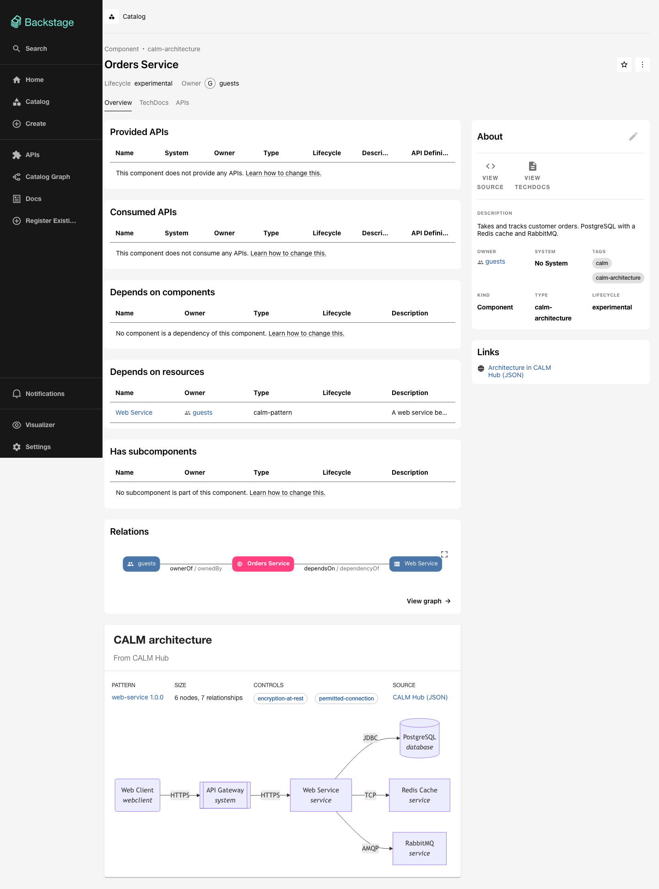

# CALM Backstage

A clone-and-run base for the CALM hackathon. A developer sees CALM architectures in the Backstage catalog, sees the
architecture on a service page, and creates a new service from a CALM pattern, with the pattern's options as form
choices. A template bundle decides what code the new service gets.



## Start

You need Docker, Node 26 and the repository's own Yarn (`.yarn/releases`, picked up by any global `yarn`).
`engines` also allows Node 22 and 24, but the base has only been run on 26.

```sh
yarn install
yarn hub:up && yarn hub:seed    # CALM Hub on http://localhost:8090, seeded from seed/
yarn start                      # Backstage on http://localhost:3100 (backend on 7107)
```

Open http://localhost:3100 and choose **Enter** to sign in as a guest. `yarn hub:down` stops the Hub and keeps its
data. To reset the Hub completely (needed after editing files in `seed/`, because Hub versions cannot change):
`docker compose -f hub/docker-compose.yml down -v`, then `yarn hub:up && yarn hub:seed` again.

The ports keep clear of other local Backstage and Hub instances on 3000, 7007, 8080 and 8088.

## What to try

1. **Catalog** (`/catalog`): the seeded architectures `orders-service` and `catalog-service` (Components, type
   `calm-architecture`), the pattern `pattern-web-service`, the controls, and the two template bundles (Resources).
   The catalog graph shows architecture → pattern → controls.
2. **Architecture page** (`orders-service`): the CALM architecture card shows the pattern, the controls and a
   Mermaid diagram.
3. **Pattern page** (`pattern-web-service`): its decisions and choices, the bundles that fit, and a link to create a
   service from it.
4. **Create** (`/create` → *Web Service (CALM pattern)*):
   - **Service**: a name.
   - **Choices**: the data store (one of PostgreSQL or MongoDB), the add-ons (any of Redis, RabbitMQ,
     OpenTelemetry) and the template bundle (`web-service@1.0.0` or `@2.0.0`).
   - **Details**: the values `calm generate` leaves open for those choices (host, ports, owner, service name).
   - The run generates the architecture, fills the values, runs `calm validate`, renders the bundle, writes the
     result to `output/<name>/` and registers it in the catalog. The new service page shows its own diagram.

`docs/demo/calm-backstage-demo.webm` (78 s) walks through all of this, ending with a new service created from the
pattern. To record it again with the Hub and Backstage running: `node docs/demo/record-demo.cjs <new-service-name>`.

Bundle 2.0.0 renders a `Dockerfile` and a `deploy/` folder that 1.0.0 does not; the data store and add-ons change
the compose services. `output/` is git-ignored, and services in it come back into the catalog after a restart.

## How it works

| Package | Role |
|---|---|
| `plugins/calm-common` | Types, annotation and entity names, pattern options reader, placeholder scanner and filler, read-only Hub client, CALM → Mermaid transform |
| `plugins/calm-node` | Runs the published `@finos/calm-cli` 1.71.0 (`generate`, `validate`, `template`) with the backend's own Node |
| `plugins/catalog-backend-module-calm` | Entity provider: reads the Hub namespaces in `calm.namespaces` and emits architectures, patterns, controls, bundles and one Template per pattern |
| `plugins/scaffolder-backend-module-calm` | Actions `calm:generate`, `calm:fill`, `calm:validate`, `calm:template`, `calm:publish:local`, `calm:register:local` |
| `plugins/calm-backend` | Routes `POST /api/calm/placeholders`, `GET /api/calm/architecture`, `GET /api/calm/pattern` |
| `plugins/calm` | Frontend: architecture and pattern entity cards, the `CalmPlaceholders` form field |
| `hub/` | CALM Hub (`finos/calm-hub:latest`, `no-auth`) and MongoDB in Docker; `seed.sh` (idempotent) |
| `seed/` | Our pattern with a `oneOf` and an `anyOf` decision, two architectures, controls in domain `hackathon-security` |
| `bundles/web-service/{1.0.0,2.0.0}` | Template bundles; `calm-backstage.json` names the pattern each one fits |

All CALM logic comes from published packages: the actions run the CLI, and the small parts the CLI does not offer as
an API (options reader, Hub client, Mermaid transform, placeholders) live in `calm-common`. `FINDINGS.md` lists them
as requests to the CALM project.

Settings are under `calm:` in `app-config.yaml` (`hubUrl`, `namespaces`, `bundles`, `publish.localDir`).

## Checks

```sh
yarn tsc
yarn test            # calm-common: options reader, Hub client, placeholders, Mermaid transform
yarn build:backend
```

## Node

- Works on Node 26.13.1 with Yarn 4.13.0: install, type check, build, start and every scaffolder run.
- `engines.node` in `package.json` was widened from `22 || 24` to `22 || 24 || 26`.
- `@backstage/create-app` 0.9.3 refuses to run on Node 26 (its prerequisite check allows only 22.x and 24.x), so the
  app was scaffolded with Node 22 (`--skip-install`). Everything after the scaffold ran on Node 26.
- `.yarnrc.yml` has a 3-day npm age gate. `@finos/calm-cli` is pre-approved there, because 1.71.0 was pinned on its
  release day.

## Further reading

- `TRACKS.md`: the work for Monday's team, cut into independent tracks.
- `FINDINGS.md`: what we learnt about the CALM CLI, CALM Hub and Backstage, and requests to the CALM project.
- `docs/superpowers/specs/2026-11-13-calm-backstage-design.md`: the design. `docs/superpowers/plans/`: one plan per
  build step, each with its results and deviations.
- `docs/plan/calm-backstage-status.html`: the build's status page.
