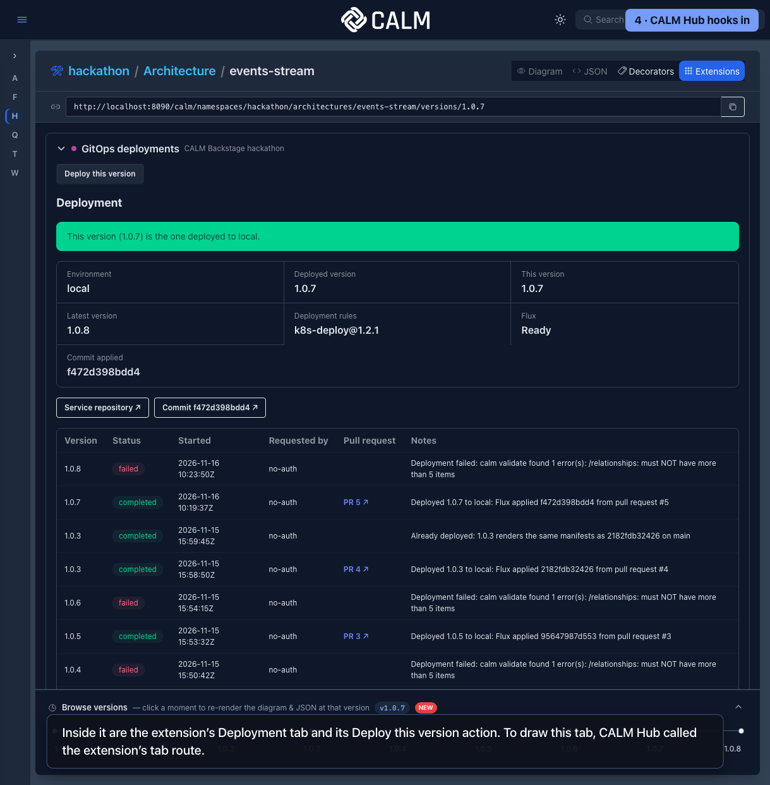

# CALM Hub deployment extension

A [CALM Hub extension](https://calm.finos.org/tutorials/advanced/hub-extension/) that deploys an architecture
**version** from CALM Hub, and records every deployment back on that version. It is the reference implementation of
a firm's deployment extension: the firm keeps its own deployment platform (here: Git, a pull request and Flux), and
plugs it into CALM Hub behind the Hub's scopes, audit and identity. [PROFILE.md](PROFILE.md) is the contract another
firm would implement against its own CD.

It works with the services [calm-backstage](../calm-backstage) creates from a CALM pattern with a starter and
deployment rules: each lives in its own Gitea repository and Flux deploys it. Nothing in calm-backstage changes; its
service card already reads the deployments this extension records.



▶ The demo (12:35, narrated; video link to follow) has a terminal on the cluster and CALM Hub side by side. It
starts with CALM Hub with no extensions and plugs this one in. Then it deploys a pattern decision from CALM Hub,
through a pull request the firm approves and Flux, and shows the results written back to CALM Hub. It ends with
the controls gate and MCP. Chapters and how to record it again: [docs/demo](docs/demo/README.md).

## What it adds to CALM Hub

On an architecture version, under **Extensions**:

- **Deployment** tab: the environment, the version deployed there and the version on screen (with a warning when
  they differ), the deployment rules, Flux's status and the commit it applied, and the deployments recorded so far.
- **Deploy this version**: after CALM Hub's confirmation, the extension
  1. records a `deployment` decorator on the version, status `pending`;
  2. runs `calm validate` on the version against its pattern and the Hub's controls (the controls gate: a version
     that fails is recorded `failed` and nothing reaches Git);
  3. re-renders the service's deployment rules (`k8s-deploy@<version>`) against that version, on a branch;
  4. opens a pull request in Gitea and merges it (`APPROVAL=auto`), or waits until someone merges it
     (`APPROVAL=manual`, the firm's change gate);
  5. asks Flux to reconcile, waits until it has applied the merge commit and the rollouts finish;
  6. marks the decorator `completed` (or `failed`, with the reason) with the pull request and commit.

  Every step updates the decorator, so the diagram's built-in *Deployments* overlay shows the progress live (CALM
  Hub re-reads decorators every 5 s). An action's own reply is not shown by CALM Hub.
- Commands, for the CLI (`calm hub ext platform-connector <command>`, once a CLI with it is published) and as MCP tools
  `ext_platform-connector_status`, `ext_platform-connector_history` and `ext_platform-connector_deploy`.

The routes need CALM Hub's `read` scope (tab, status, history) or `write` scope (deploy) on the namespace, and every
call that deploys is in CALM Hub's audit log; its audit id is stored on the decorator and in the commit message.

## Run it

You need calm-backstage's local stack running (see its README): `yarn install`, `yarn hub:up && yarn hub:seed`,
`yarn k8s:up`, and a service created with a starter and `k8s-deploy` (README step 7), for example `events-stream`
from the event-streaming Template.

```sh
cd calm-hub-deploy-extension
npm install
npm run hub:up          # restarts CALM Hub on finos/calm-hub:sha-96fe367 with this extension (keeps its data)
npm start               # the extension on :8093
```

`npm run hub:up` (`scripts/hub-up.sh`) layers `hub/compose.override.yml` over calm-backstage's
`hub/docker-compose.yml`: the Hub image with the extension framework (`latest` and `0.7.7` predate it), the manifest
folder, a P-256 signing key pair in `.keys/` (made on first run), and MCP turned on. Run calm-backstage's
`yarn hub:up` to go back to its own Hub. `scripts/hub-up.sh --without-extensions` runs the same Hub with no
extension loaded. To use a calm-backstage checkout elsewhere:
`CALM_BACKSTAGE_DIR=/path/to/calm-backstage npm run hub:up`.

Settings (environment variables; defaults match calm-backstage's `app-config.yaml`):

| Variable | Default | |
|---|---|---|
| `PORT` | `8093` | CALM Hub's `backend-url` points here (`http://host.docker.internal:8093`) |
| `CALM_HUB_URL` | `http://localhost:8090` | |
| `APPROVAL` | `auto` | `manual`: wait for a person to merge the pull request |
| `APPROVAL_TIMEOUT_SECONDS` | `1800` | |
| `FLUX_TIMEOUT_SECONDS` | `300` | |
| `DEPLOY_ENVIRONMENT` | `local` | recorded on every deployment |
| `CALM_KUBECONFIG` | `../calm-backstage/.kube/config` | the cluster `yarn k8s:up` made |
| `GITEA_URL`, `GITEA_USER`, `GITEA_PASSWORD` | `http://localhost:3300`, `calm`, `calm-local-dev` | |
| `BUNDLE_REGISTRY_URL` | `http://localhost:5050` | where the deployment rules are pulled from |
| `DEPLOY_NAMESPACES` | `hackathon` | where unfinished deployments are closed on start-up |

## Try it

```sh
# A new version of events-stream that changes a pattern decision: the broker keeps its topics in SQLite.
npx tsx scripts/new-version.ts hackathon events-stream --choose "broker-storage=SQLite on the broker’s volume"
```

Open the new version in CALM Hub (http://localhost:8090, *hackathon* → *events-stream* → the newest version →
**Extensions**): the tab warns that the cluster runs the previous version. Choose **Deploy this version** → **Run**,
then watch the overlay on the **Diagram** and the record on **Decorators**. In the cluster the PostgreSQL Deployment
and its two network policies go away (`kubectl -n calm-events-stream get deploy,networkpolicies`).

```sh
# A version the pattern does not allow: the browser connects to the service directly, past the gateway.
npx tsx scripts/new-version.ts hackathon events-stream --connect web-client:stream-app
```

Deploying it stops at the controls gate: the decorator says `failed` with the validation error, and no pull request
is opened. The same through the API (what the CLI and MCP tools call):

```sh
curl -X POST -H 'content-type: application/json' -d '{}' \
  localhost:8090/api/calm/extensions/platform-connector/api/namespaces/hackathon/architectures/events-stream/versions/1.0.1/deployments
curl localhost:8090/api/calm/extensions/platform-connector/api/namespaces/hackathon/architectures/events-stream/status
```

Deploying the version that already runs is a no-op recorded as `completed` ("Already deployed").

## How it works

| File | Role |
|---|---|
| `extension/platform-connector/extension.json` | The manifest CALM Hub loads: routes, scopes, commands (with the profile's schemas), the tab and the action. The backend builds its route table from it. |
| `src/identity.ts` | Verifies CALM Hub's signed assertion (`X-Calm-Hub-Identity`) against the Hub's JWKS: signature, issuer, audience, method, path, body hash, expiry, replay. A port of upstream `identity.mjs`. |
| `src/app.ts`, `src/server.ts`, `src/routes.ts` | Exact-path routing (no decoding), verification, the namespace CALM Hub checked must be the one acted on, handlers. |
| `src/resolve.ts` | Context → architecture (by name, as the Hub UI sends it, or numeric id); reads the service's `catalog-info.yaml` and manifests from Gitea over HTTP; refuses a repository that names another namespace's architecture. |
| `src/status.ts`, `src/blocks.ts` | Status (Flux, deployed version, history from decorators) and the tab's blocks. |
| `src/deploy/job.ts` | The deployment job and its decorator lifecycle; one job per service at a time. |
| `src/deploy/kube.ts` | Flux and rollout helpers ported from calm-backstage's scaffolder actions. |
| `scripts/new-version.ts` | Stores the next version of an architecture, changed by a pattern decision or with a forbidden connection. |

It depends on calm-backstage's `calm-common` (Hub client, decorators, Flux, Gitea) and `calm-node` (git, kubectl,
`calm validate` and `calm template`, OCI bundles) through `file:` dependencies, run with `tsx`. `npm test` runs the
tests (vitest): the identity checks, the route table, and the read and deploy paths against an in-memory Hub, a
Gitea backed by real bare git repositories, and a kubectl whose Flux follows `main`.

## Limits

- CALM Hub runs without auth here, so every caller is `no-auth`: `requested-by` is always `no-auth`. With the Hub on
  OIDC it is the user, and a firm would check its own entitlements (who may deploy to production) with it.
- Jobs live in memory: on start-up, deployments this extension left `pending` or `in-progress` are marked `failed`.
- One environment per instance. Promotion between environments would be one instance per environment, or the
  profile's `environment` input (PROFILE.md).
- Backstage's working copy `output/<name>` and its catalog entity keep the old `architecture-version` until they are
  pulled again (the next upgrade does that).
- The extension only redeploys services that are already in Flux; it does not create the Flux objects.

[FINDINGS.md](FINDINGS.md) lists what the build found out about the extension framework, as requests to CALM.
