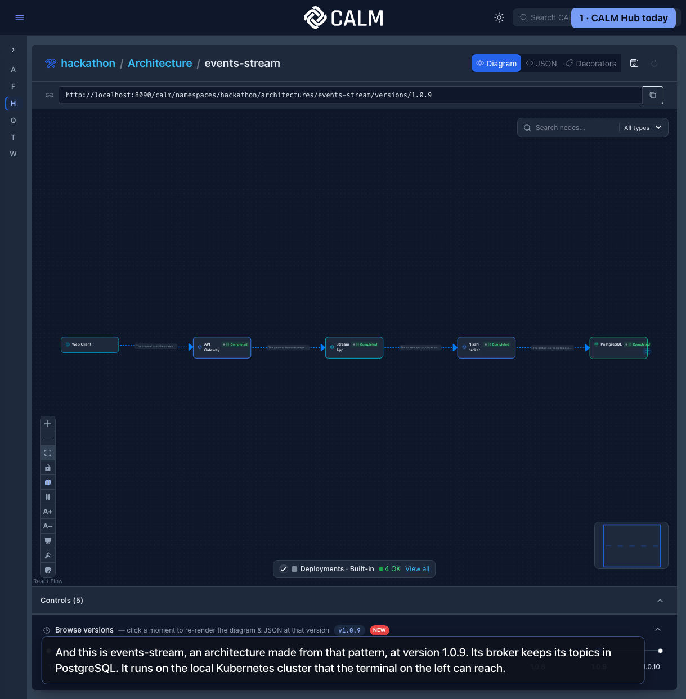
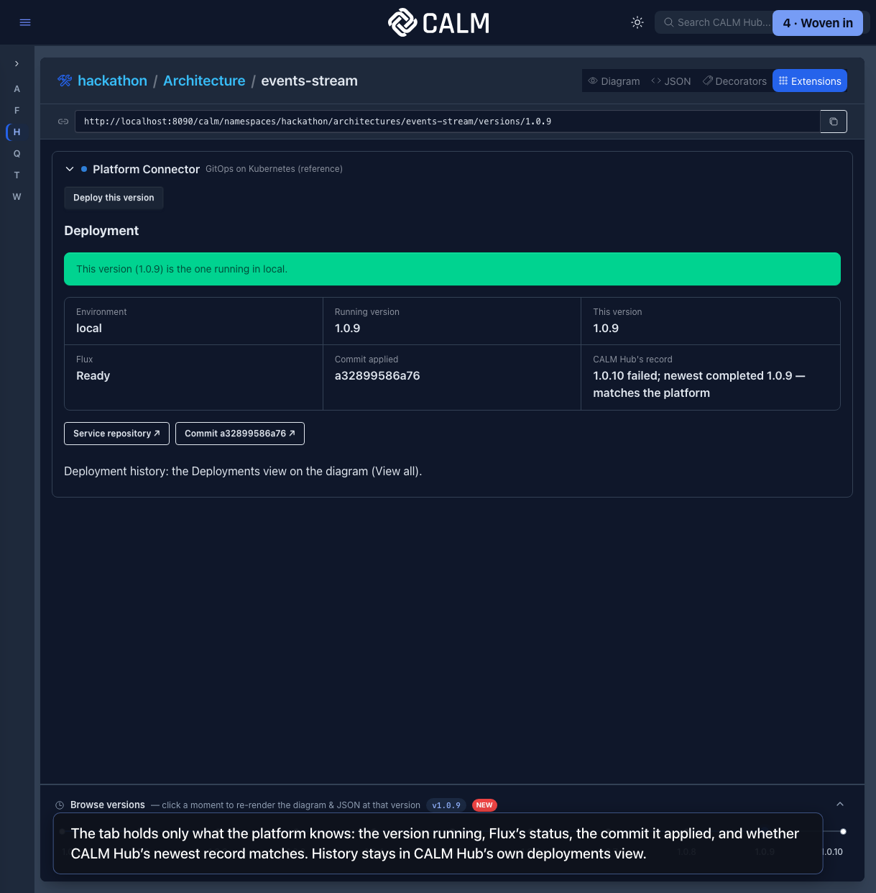

# Demo: plugging a Platform Connector into CALM Hub

A narrated walkthrough (1920×1080, one take, 13:22, in the presenter's cloned voice) with a
terminal on the local cluster on the left and CALM Hub on the right. It starts with a tour of CALM Hub as it ships:
namespaces, a pattern and its decisions, a control, an architecture, and the built-in deployment records, which are
write-only. Then it plugs in the Platform Connector and shows it woven into CALM Hub's own screens. The connector
spots drift that a record cannot know about, deploys a changed pattern decision through the firm's pull request
approval and Flux, and refuses a version that breaks a control.

The video is not kept in this repository. It is published separately (link to follow), with
`calm-hub-deploy-demo.srt` as its captions. `record-hub-demo.cjs` writes both files.

The take works out its versions from what runs. `events-stream` (a Nisshi event-streaming service from
calm-backstage) runs one version. The take deploys the next version, with the broker's storage flipped between
PostgreSQL and SQLite. Then it tries the version after that, which the pattern forbids.

| | Chapter | What it shows |
|---|---|---|
| 0:00 | CALM Hub today | The home page, with namespaces and control domains and no Extensions section. The `hackathon` namespace, the event-streaming pattern and its open decision (where the broker keeps its topics), and the Permitted Connection control in `hackathon-security`. `events-stream` and the `security` control on each connection. The registry lists only the two built-in decorator views. |
| 1:27 | Deployment records are write-only | The built-in Deployments overlay, a node's badge and its details, and "View all" (the Decorators tab filtered to deployments). Any tool can write these records, but CALM Hub cannot tell whether one is still true, start a deployment, or stop one that breaks a control. |
| 2:06 | A Platform Connector | The manifest: routes and scopes, contributions (action, Deployment tab, node detail panel, landing card, Services screen) and commands. Starts the backend with manual approval and restarts CALM Hub with it. The registry lists `platform-connector` and the MCP server has its tools. CALM Hub signs every call. |
| 4:21 | Woven in | The home page card (services, in sync, drifted). The Extensions tab with the Deploy action and the trimmed Deployment tab. The node sidebar's Platform panel for `stream-app` (workload, replicas, image, network policies, the record that covers it). The connector's log of the calls CALM Hub made. |
| 5:24 | Drift: what a record can't know | `stream-app` scaled to 0 behind Git's back. The panel and the tab show the drift while the deployment badge still says completed. `reconcile.sh` asks Flux to put it back, and the panel shows in sync again. |
| 6:26 | A decision changes, and the connector deploys it | A new version with the broker's storage flipped, and the tab's warning. Deploy, the confirm dialog and Run. The controls gate comes first, then the standard deployment record goes pending and in progress on the Decorators tab and the overlay. The pull request in Gitea (files, and a commit message with who asked and the audit id), the approver merges, Flux applies, and the record ends completed. The record's `$schema`, `data.kubernetes` and `data.gitops`, CALM Hub's audit line with the same id, CALM Hub refusing a copy without `data.kubernetes.namespace` (HTTP 400), and the GitOps sub-standard in CALM Hub's Standards. |
| 10:35 | The controls gate, as a control evaluation | A version with a forbidden connection is refused at the gate. No deployment record and no pull request, and the cluster is unchanged. The built-in Control evaluations overlay marks the connection and both nodes not met, and the details give the finding. |
| 11:52 | The same connector, for an agent | The status and history commands as MCP tools: in sync, no drift, the workloads, CALM Hub's newest record, and the deployments and the refusal. |
| 12:51 | The pattern | Recap. CALM Hub's standards keep it tool-neutral, and a connector adds understanding and action. Another firm writes one for its own platform against PROFILE.md. |






## Re-voice a take

`revoice.cjs` speaks a finished take's lines again, with a different voice or provider. Each line goes back at the
time the take spoke it, over the same footage. It needs no new take, so nothing changes in CALM Hub, Gitea or the
cluster. A line longer than the gap before the next one is sped up to fit, and the script lists it.

```sh
DEMO_TTS=elevenlabs DEMO_VOICE=<voice id> node docs/demo/revoice.cjs <take-dir> [out-dir]
```

## Record it again

**Needs:**
- calm-backstage's stack, with `events-stream` deployed through Flux and in sync (the event-streaming Template with
  the `nisshi-stream-app` starter and `k8s-deploy`);
- this extension's Hub (`npm run hub:up`), and the GitOps sub-standard in CALM Hub
  (`npx tsx scripts/publish-standard.ts`);
- `ttyd`, `ffmpeg`, `jq` and `kubectl` on the PATH, and macOS `say`;
- Playwright, which comes from calm-backstage's `node_modules`.

```sh
CALM_KUBECONFIG=/path/to/calm-backstage/.kube/config node docs/demo/record-hub-demo.cjs <out-dir>
node docs/demo/record-hub-demo.cjs <out-dir> --audio-only    # speak and time the narration only
```

**What one take does:**
- **Checks first:** before it touches anything, it checks that every beat the recorder speaks is in
  `narration.cjs` and every beat there is spoken. It also checks that `events-stream` is in sync and that the
  sub-standard is published.
- **Restarts:** it restarts CALM Hub twice (without the extension, then with it) and runs the backend with manual
  approval. It leaves the backend running on auto approval afterwards.
- **Drift:** it scales `stream-app` to 0 and asks Flux to reconcile. Flux would put it back by itself within a
  minute, so the take reads Flux's log at the start of chapter 4. It spreads any wait over the pauses after chapter
  4's beats, so the scale starts just after one of Flux's runs, then checks again before scaling. If Flux still puts
  the workload back before the drift is shown, the take stops with a message saying so. Nothing else has changed by
  then, so run it again.
- **Checks during the take:** the home page card's counts are read before the take, for the narration, and checked
  again before they are spoken. Once a version is stored, a step that only shows something (a page, a badge, a
  highlight) warns and carries on rather than stopping the take with a pull request left open. The steps that check
  real state still stop it: the record exists, the pull request is open, the deployment completed, the version was
  refused.
- **New versions:** it stores two new versions of `events-stream` in CALM Hub, which can't be deleted. One flips
  the broker's storage between PostgreSQL and SQLite, so every take deploys a real change. The other has a
  connection the pattern forbids.
- **A refused record:** it posts one copy of the new deployment record without `data.kubernetes.namespace`
  (`broken-copy.sh`). CALM Hub refuses it, so nothing is stored. The script posts only a copy of a record stamped
  with the Kubernetes standard CALM Hub bundles, and fails unless CALM Hub answers HTTP 400.
- **Version numbers:** the recorder works out the version numbers and the storage choice from what runs.
- **Kubeconfig:** set `CALM_KUBECONFIG` when this folder isn't next to the calm-backstage checkout that made the
  cluster, for example in a git worktree.

**Narration:** `narration.cjs` holds the voiceover as beats. `voice.cjs` speaks each beat, caches it under
`.work/demo-audio/`, and the recorder shows it as the caption while it plays. Two voices are available:
- macOS `say`, the default: `DEMO_VOICE` (default Daniel) at `DEMO_RATE` (default 170 words a minute);
- ElevenLabs: `DEMO_TTS=elevenlabs` with `ELEVENLABS_API_KEY` and `DEMO_VOICE` set to a voice id, which can be a
  clone of the presenter's voice.

`pronunciation.cjs` respells, for the voice only, the words it gets wrong (for example PostgreSQL as "Postgres").
The captions keep the real spelling.

Each step is held until its beat has been spoken. Typing, holds and waits are 3× the first take's pace. After the
take, the beats are laid under the joined video at the times they were spoken, and the same times give the `.srt`.

| File | |
|---|---|
| `record-hub-demo.cjs` | Drives a ttyd terminal and CALM Hub in two Playwright pages, joins both recordings with ffmpeg and adds the voiceover |
| `narration.cjs` | The voiceover and the terminal's comments, one beat each |
| `pronunciation.cjs` | How the voice should say words it gets wrong (voice only; captions keep the spelling) |
| `voice.cjs` | Speaks the beats with macOS `say` or ElevenLabs, cached |
| `revoice.cjs` | Re-voices a finished take over the same footage |
| `demo.rc` | bash rc for the terminal: `$HUB`, `$EXT`, `$GITEA`, `$NS`, `k`, and the prompt counter the recorder waits on |
| `start-extension.sh` | (Re)starts the backend in the background with `auto` or `manual` approval |
| `watch-deploy.sh` | Live view of one version's newest attempt: its record in CALM Hub, Flux, the Deployments and network policies. Ends when the attempt completes, fails or is refused at the controls gate (`UNTIL=approval` stops at the pull request) |
| `reconcile.sh` | Asks Flux to reconcile a service's Kustomization now, and waits until Flux has handled the request |
| `broken-copy.sh` | Posts a copy of a deployment record without `data.kubernetes.namespace`, to show CALM Hub refusing it (HTTP 400) |
| `ext-log.sh` | The backend's log: the calls CALM Hub made, and the deployment steps |
| `approve-pr.sh` | Merges the pull request, as the approver would |
| `hub-audit.sh` | CALM Hub's audit line for one call, by its audit id |
| `mcp.sh` | Calls a tool on CALM Hub's MCP server, or lists the tools (`--list`) |
