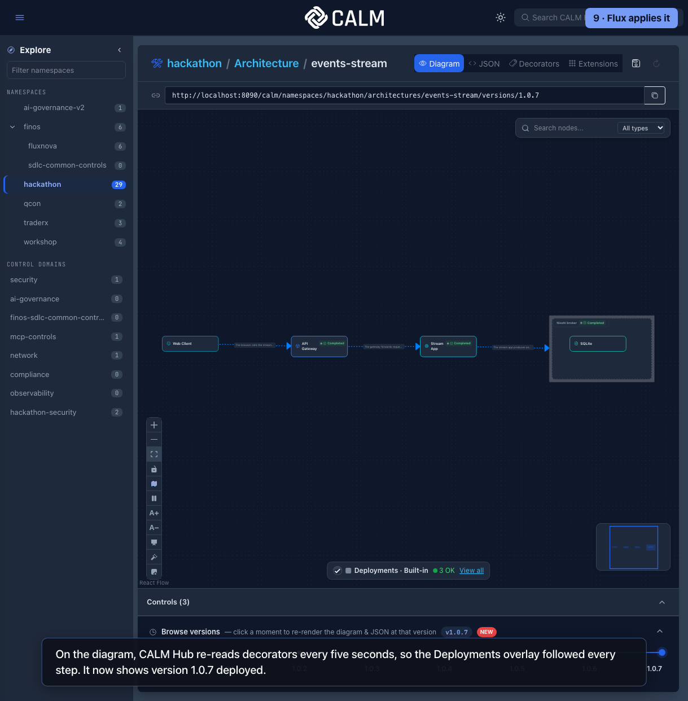

# Demo: plugging a Platform Connector into CALM Hub

A narrated walkthrough (1920×1080, one take, 15:52, in the presenter's cloned voice) with a
terminal on the local cluster on the left and CALM Hub on the right. It opens full screen on a title and the contents,
and each chapter opens on its own full-screen card saying what it will show. It starts with a tour of CALM Hub as it ships:
namespaces, a pattern and its decisions, a control, an architecture, and the built-in deployment records, which are
write-only. Then it plugs in the Platform Connector and shows it woven into CALM Hub's own screens. The connector
spots drift that a record cannot know about, deploys a changed pattern decision through the firm's pull request
approval and Flux, and refuses a version that breaks a control or names no pattern. Then its sensors show the controls
holding at runtime: a deleted network policy turns its connection red on CALM Hub's diagram within seconds, and green
again once Flux puts it back.

The table gives the times of the newest take (15:52, with *Controls at runtime: evidence* and the chapter cards). The
video on YouTube is an older take, without that chapter or the cards.

▶ [Watch it on YouTube](https://youtu.be/0r6zxzfNzJE). The video is not kept in this repository; YouTube has it, with
`calm-hub-deploy-demo.srt` as its captions. `record-hub-demo.cjs` writes both files.

The take works out its versions from what runs. `events-stream` (a Nisshi event-streaming service from
calm-backstage) runs one version. The take deploys the next version, with the broker's storage flipped between
PostgreSQL and SQLite. Then it tries the version after that, which the pattern forbids, and one that names no
pattern.

| | Chapter | What it shows |
|---|---|---|
| 0:00 | Introduction and contents | Full screen: the title, then the ten chapters, each picked out as the narration names it. Every chapter below starts on its own card (chapter number, title, what it shows, and a strip of all ten). |
| 0:41 | CALM Hub today | The home page, with namespaces and control domains and no Extensions section. The `hackathon` namespace, the event-streaming pattern and its open decision (where the broker keeps its topics), and the Permitted Connection control in `hackathon-security`. `events-stream` and the `security` control on each connection. The registry lists only the two built-in decorator views. |
| 2:24 | Deployment records are write-only | The built-in Deployments overlay, a node's badge and its details, and "View all" (the Decorators tab filtered to deployments). Any tool can write these records, but CALM Hub cannot tell whether one is still true, start a deployment, or stop one that breaks a control. |
| 3:15 | A Platform Connector | The manifest: routes and scopes, contributions (action, Deployment tab, node detail panel, landing card, Services screen) and commands. Starts the backend with manual approval and restarts CALM Hub with it. The registry lists `platform-connector` and the MCP server has its tools. CALM Hub signs every call. |
| 4:57 | Woven in | The home page card (services, in sync, drifted). The Extensions tab with the Deploy action and the trimmed Deployment tab. The node sidebar's Platform panel for `stream-app` (workload, replicas, image, network policies, the record that covers it). The connector's log of the calls CALM Hub made. |
| 6:13 | Drift: what a record can't know | `stream-app` scaled to 0 behind Git's back. The panel and the tab show the drift while the deployment badge still says completed. `reconcile.sh` asks Flux to put it back, and the panel shows in sync again. |
| 7:06 | A decision changes, and the connector deploys it | A new version with the broker's storage flipped, and the tab's warning. Deploy, the confirm dialog and Run. The controls gate comes first, then the standard deployment record goes pending and in progress on the Decorators tab and the overlay. The pull request in Gitea (files, and a commit message with who asked and the audit id), the approver merges, Flux applies, and the record ends completed. The record's `$schema`, `data.kubernetes` and `data.gitops`, CALM Hub's audit line with the same id, CALM Hub refusing a copy without `data.kubernetes.namespace` (HTTP 400), and the GitOps sub-standard in CALM Hub's Standards. |
| 10:21 | The controls gate, as a control evaluation | A version with a forbidden connection is refused at the gate. No deployment record and no pull request, and the cluster is unchanged. The built-in Control evaluations overlay marks the connection and both nodes not met, and the details give the finding. A version that names no pattern is refused too: the gate fails closed. |
| 11:54 | Controls at runtime: evidence | The sensors' control evaluations on the diagram (all met) and the tab's "Runtime checks holding". `api-gateway-stream-app-ingress` deleted: the connection turns not met within seconds, and its sidebar shows the evidence record (CALM's `meta/evidence.json`, expected against observed, `observed-at` and `valid-until`) and the control evaluation linking to it. Flux puts the policy back and it is met again. `default-deny` deleted: every connection fails at once, until Flux heals it. |
| 14:12 | The same connector, for an agent | The status, history and verify commands as MCP tools: in sync, no drift, the workloads, CALM Hub's newest record, the deployments and the refusals, and every runtime check holding. |
| 15:06 | The pattern | Recap. CALM Hub's standards keep it tool-neutral, and a connector adds understanding and action. Another firm writes one for its own platform against PROFILE.md. |




## Re-voice a take

Prefer a fresh take timed to the new voice. Re-voicing keeps the old timing, so a voice that speaks faster than the
one the take was timed to leaves silences of uneven length between the lines.

`revoice.cjs` speaks a finished take's lines again, with a different voice or provider. Each line goes back at the
time the take spoke it, over the same footage. It needs no new take, so nothing changes in CALM Hub, Gitea or the
cluster. A line longer than the gap before the next one is sped up to fit, and the script lists it.

```sh
DEMO_TTS=elevenlabs DEMO_VOICE=<voice id> node docs/demo/revoice.cjs <take-dir> [out-dir]
```

## Record it again

**Needs:**
- calm-backstage's stack, with `events-stream` deployed through Flux and in sync (the event-streaming Template with
  the `nisshi-stream-app` starter and `k8s-deploy`);
- this extension's Hub (`npm run hub:up`), and the GitOps sub-standard in CALM Hub
  (`npx tsx scripts/publish-standard.ts`);
- `ttyd`, `ffmpeg`, `jq` and `kubectl` on the PATH, and macOS `say`;
- Playwright, which comes from calm-backstage's `node_modules`.

```sh
CALM_KUBECONFIG=/path/to/calm-backstage/.kube/config node docs/demo/record-hub-demo.cjs <out-dir>
node docs/demo/record-hub-demo.cjs <out-dir> --audio-only      # speak and time the narration only
node docs/demo/record-hub-demo.cjs <out-dir> --captions-only   # the take with captions and no audio track
```

`--captions-only` is for reviewing the story before it is voiced. The beats are still timed by a voice (macOS `say`
by default, or set `DEMO_TTS`), so each caption shows for as long as its line would take to speak. It writes
`calm-hub-deploy-demo-captions.mp4` and `.srt`. For the voiced take, record again with the final voice rather than
re-voicing this one.

**What one take does:**
- **Checks first:** before it touches anything, it checks that every beat the recorder speaks is in
  `narration.cjs` and every beat there is spoken. It also checks that `events-stream` is in sync and that the
  sub-standard is published.
- **Restarts:** it restarts CALM Hub twice (without the extension, then with it) and runs the backend with manual
  approval. It leaves the backend running on auto approval afterwards.
- **Off camera, first:** it deletes the runtime evidence records earlier runs of the connector left in CALM Hub
  (evidence decorators and the sensors' control evaluations), so chapters 1 and 2, CALM Hub as it ships, show none.
  The sensors write fresh ones once the connector is plugged in. It also sets the service's Flux Kustomization to
  reconcile only every 60 minutes for the take, and puts the interval back afterwards (also when the take fails).
- **Drift and runtime evidence:** it scales `stream-app` to 0 (chapter 5), and deletes the network policy
  `api-gateway-stream-app-ingress` and then `default-deny` (chapter 8). Each time it asks Flux to put things back
  with `reconcile.sh`, after showing the change. Flux's own run would otherwise heal it within a minute, possibly
  before it is shown, which is why its interval is lengthened for the take. If a deleted policy does not show as not
  met, the take stops and says so.
- **Checks during the take:** the home page card's counts are read before the take, for the narration, and checked
  again before they are spoken. Once a version is stored, a step that only shows something (a page, a badge, a
  highlight) warns and carries on rather than stopping the take with a pull request left open. The steps that check
  real state still stop it: the record exists, the pull request is open, the deployment completed, the version was
  refused.
- **New versions:** it stores three new versions of `events-stream` in CALM Hub, which can't be deleted. One flips
  the broker's storage between PostgreSQL and SQLite, so every take deploys a real change. One has a connection the
  pattern forbids. One names no pattern (`scripts/new-version.ts --no-pattern`).
- **A refused record:** it posts one copy of the new deployment record without `data.kubernetes.namespace`
  (`broken-copy.sh`). CALM Hub refuses it, so nothing is stored. The script posts only a copy of a record stamped
  with the Kubernetes standard CALM Hub bundles, and fails unless CALM Hub answers HTTP 400.
- **Version numbers:** the recorder works out the version numbers and the storage choice from what runs.
- **Kubeconfig:** set `CALM_KUBECONFIG` when this folder isn't next to the calm-backstage checkout that made the
  cluster, for example in a git worktree.

**Narration:** `narration.cjs` holds the voiceover as beats. `voice.cjs` speaks each beat, caches it under
`.work/demo-audio/`, and the recorder shows it as the caption while it plays. Two voices are available:
- macOS `say`, the default: `DEMO_VOICE` (default Daniel) at `DEMO_RATE` (default 170 words a minute);
- ElevenLabs: `DEMO_TTS=elevenlabs` with `ELEVENLABS_API_KEY` and `DEMO_VOICE` set to a voice id, which can be a
  clone of the presenter's voice.

`pronunciation.cjs` respells, for the voice only, the words it gets wrong (for example PostgreSQL as "Postgres").
The captions keep the real spelling.

**One voice throughout:** `voice.cjs` voices the lines in order and stitches them: each ElevenLabs request carries the
request ids of the three lines before it (`previous_request_ids`), with stability 0.7 and a fixed seed (`DEMO_SEED`,
default 1234). Voiced one request at a time, the clone came back in two characters, most lines quiet and bright and
about one in twelve 18 dB louder and darker, and evening the level did not even the tone. A new clip louder than -32
LUFS as voiced is in the loud mode and is voiced again with another seed before the next line is stitched to it. Each
request id is saved beside its clip (`.request.json`); ElevenLabs keeps them for two hours, so a line voiced later than
that after the lines before it fails rather than come out unstitched.

**Level:** ElevenLabs returns clips of the same voice at very different levels (measured -39 to -19 LUFS in one
narration). `voice.cjs` works out a fixed gain for each clip that brings it to -16 LUFS through a limiter at -3 dBFS
(cached beside the clip as `.gain.json`), and the join encodes the voice at AAC 192k (128k overshot the limit by up to
3 dB on a sharp onset).

**Checks before anyone watches it:** after the join, `check-take.cjs` checks the clips as voiced (at most 5 LU apart
before the gain, since a clip in the loud mode sounds like a different take even at the same level), then measures every line in the finished video (each
within 1.5 LU of -16 LUFS, at most 2 LU apart, true peaks under -0.5 dBFS, and the pauses inside each line under -45 dB
RMS, since the gain lifts the clone's room tone and breath with the voice) and puts a frame from the middle of every
line, and the frames either side of every card's cuts, on labelled contact sheets (`sheets/`). Look at every sheet: a line that describes the screen
must be true of the frame it plays over. The results are in `qa.json`; the take exits non-zero if the level fails.
`remix-audio.cjs <take-dir>` lays the same lines under a take again at the same times, for a change to the level
only, and runs the checks.

**Cards:** the title, the contents and the chapter cards are a third recorded page (1920×1080), laid over both panes
while a card is up. Steps that only prepare a chapter (a `clear`, CALM Hub reloading its extensions, waiting for the
sensors) run under its card.

Each step is held until its beat has been spoken, and the next beat follows after the same short gap (0.5 s)
everywhere, so nothing lingers on screen after a line ends. Typing is 3× the first take's pace. After the take, the
beats are laid under the joined video at the times they were spoken, and the same times give the `.srt`. The take
also lists every silence between two lines longer than 1.2 s, in `silences.json` and on the console: usually a beat
whose actions outlast its line. Fix those (a longer line, a shorter action) before anyone watches the take.

| File | |
|---|---|
| `record-hub-demo.cjs` | Drives a ttyd terminal and CALM Hub in two Playwright pages, joins both recordings with ffmpeg and adds the voiceover |
| `narration.cjs` | The voiceover and the terminal's comments, one beat each |
| `pronunciation.cjs` | How the voice should say words it gets wrong (voice only; captions keep the spelling), e.g. FINOS as "Fin-oss", route as "root", SQLite as "sequel-lite", JSON as "Jay-son" |
| `new-version.sh`, `deploy.sh` | Short commands for the take: store a new version (`scripts/new-version.ts`); deploy a version as the button does, through CALM Hub's extension API, and follow it |
| `SCRIPT.md` | The bulleted script of the changes for the runtime evidence chapter, as reviewed |
| `voice.cjs` | Speaks the beats with macOS `say` or ElevenLabs, cached, and evens their level (`voiceMix`) |
| `check-take.cjs` | Checks a finished take: the level of every line, and a frame per line on contact sheets |
| `remix-audio.cjs` | Lays the same lines under a take again at the same times (a level change only), then checks it |
| `revoice.cjs` | Re-voices a finished take over the same footage |
| `demo.rc` | bash rc for the terminal: `$HUB`, `$EXT`, `$GITEA`, `$NS`, `k`, and the prompt counter the recorder waits on |
| `start-extension.sh` | (Re)starts the backend in the background with `auto` or `manual` approval |
| `watch-deploy.sh` | Live view of one version's newest attempt: its record in CALM Hub, Flux, the Deployments and network policies. Ends when the attempt completes, fails or is refused at the controls gate (`UNTIL=approval` stops at the pull request) |
| `reconcile.sh` | Asks Flux to reconcile a service's Kustomization now, and waits until Flux has handled the request |
| `broken-copy.sh` | Posts a copy of a deployment record without `data.kubernetes.namespace`, to show CALM Hub refusing it (HTTP 400) |
| `ext-log.sh` | The backend's log: the calls CALM Hub made, and the deployment steps |
| `approve-pr.sh` | Merges the pull request, as the approver would |
| `hub-audit.sh` | CALM Hub's audit line for one call, by its audit id |
| `mcp.sh` | Calls a tool on CALM Hub's MCP server, or lists the tools (`--list`) |
