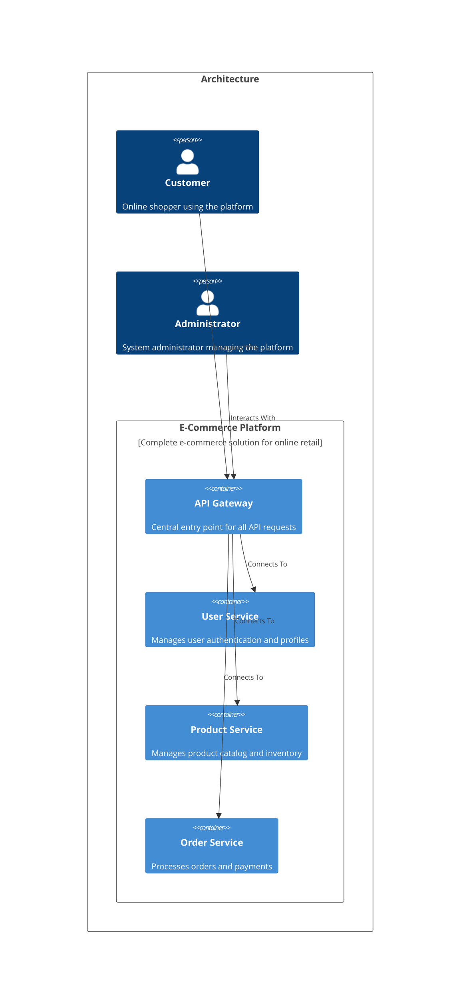

<!-- Copied from finos/architecture-as-code@444f932c8eb289e5887a3abc205c51a6e3e75c7d shared/test_fixtures/docify/c4/ecommerce-architecture/ecommerce-architecture.md; its CALM input is ecommerce-architecture.arch.json next to it. -->
---
architecture: ../ecommerce-architecture/ecommerce-architecture.arch.json
---
